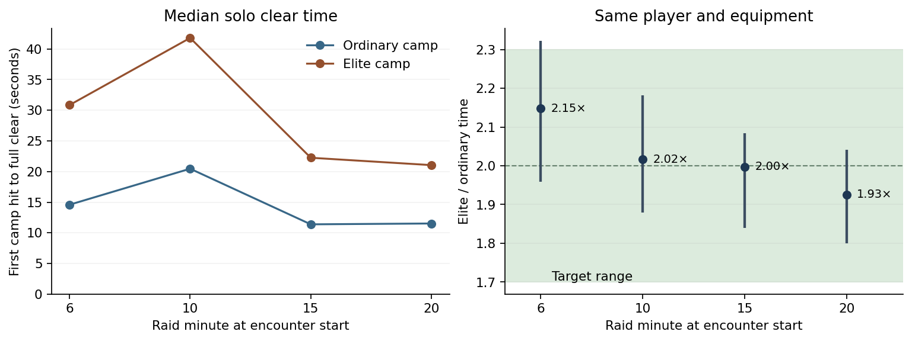

# Solo elite clear time

The design target is a full elite camp in roughly twice the time of a comparable normal camp after minute five. A clear includes the boss and living escorts. Time starts when the scripted player first damages a member of the camp. A group of bots resuming a partially cleared camp answers a different pacing question.

## Calibration

Four generated maps supplied 80 matched attempts per starting age. Each map supplied ten elite types and two weapon choices, sword and bow. Within a pair, the fighter used the same faction, weapon, farm stat inventory, prepared cards and Wish logic on both camps. Each control was a real normal camp in the same zone, preferentially with the same base mob type. The 40 Hz simulator started both camps fresh at the specified raid age. It kept normal combat mechanics, disabled terrain damage and natural regeneration, and allowed 180 seconds per attempt.

| Starting minute | Previous median elite/normal | Full normal defense on elites | Selected curve |
| ---: | ---: | ---: | ---: |
| 0 | 2.27× | 2.27× | 2.27× |
| 6 | 1.73× | 2.36× | 2.21× |
| 10 | 1.02× | 2.27× | 1.99× |
| 15 | 0.85× | 2.26× | 1.97× |
| 20 | 0.74× | 2.27× | 1.89× |

The exploratory table used the fighter’s first logged hit as its start. A stray hit can land on another mob. We subsequently replayed the original and selected pilot rules with the clock starting on the first positive settled hit to the selected camp. Fight outcomes and end ticks reproduced exactly. Both held-out tables below use the corrected clock, including damage from owned companions. [Pilot baseline on settled camp contact](calibration_before_settled.csv) · [Selected pilot on settled camp contact](calibration_selected_settled.csv)

The ratios are medians for pairs that cleared both. At minute ten the old rules produced 65 elite clears and 13 deaths in 80 attempts. Giving elites the same defensive ramp as normal camps produced 22 clears and 55 deaths. The selected curve produced 58 clears and 18 deaths. The remaining attempts ended without a clear or death. [Baseline trial](calibration_before.csv) · [Full-defense trial](calibration_full_defense.csv) · [Selected trial](calibration_selected.csv)

## First held-out cohort

The common 75% defense ramp passed the prespecified aggregate band on ten new generated maps (21–30). Each age has 200 paired attempts. On the same maps, the bosses at minute twenty ranged from Archon at 1.15× to Avalanche Troll at 2.72×. We used those systematic differences to specify the type-specific follow-up below.

| Start | Previous ratio | Common ramp | 95% map-bootstrap interval, common ramp | Matched completions |
| ---: | ---: | ---: | ---: | ---: |
| 6 min | 1.74× | 2.21× | 2.18–2.33 | 119 |
| 10 min | 1.00× | 2.06× | 2.01–2.15 | 124 |
| 15 min | 0.84× | 1.98× | 1.87–2.10 | 166 |
| 20 min | 0.74× | 1.93× | 1.85–2.00 | 171 |

All ordinary camp rows and all opening rows were identical to the earlier rules. In 200 minute-ten elite attempts the common ramp took elite deaths from 39 to 61 and full clears from 158 to 134. The remaining cases timed out or failed to engage. [Original rules](heldout_before.csv) · [Common ramp](heldout_selected.csv)

## Independent test of the final rule

Ten further maps (41–50) supplied 200 paired solo attempts per age. The prespecified aggregate interval was 1.70–2.30×. All four post-opening medians met it. The uncertainty intervals resample whole maps, preserving the dependence between gear and bosses on the same map.

| Start | Normal clear median | Elite clear median | Median paired ratio | 95% map interval | Both cleared | Elite deaths |
| ---: | ---: | ---: | ---: | ---: | ---: | ---: |
| 6 min | 14.59 s | 30.85 s | 2.15× | 1.96–2.32 | 127/200 | 70 |
| 10 min | 20.46 s | 41.80 s | 2.02× | 1.88–2.18 | 144/200 | 44 |
| 15 min | 11.39 s | 22.25 s | 2.00× | 1.84–2.08 | 167/200 | 22 |
| 20 min | 11.53 s | 21.05 s | 1.93× | 1.80–2.04 | 170/200 | 17 |

The corrected clock changed the start on 20 of the 2,000 final-map attempts, including nine clears. Every end tick and outcome matched the original run. Absolute medians include every clear of that camp type. The paired ratio compares the same fighter on the two camps and requires a positive normal time. The remaining elite attempts include clears paired with an unsuccessful ordinary attempt, timeouts and attempts that never engaged. The CSV records every denominator. The opening rows and ordinary camp rows were identical under the common and type-specific rules on all ten maps. [Final rules](heldout_by_type.csv) · [Common-rule control on the same maps](heldout_common_by_type.csv)

| Boss | Common rule | Final rule |
| --- | ---: | ---: |
| Archon | 1.42× | 2.18× |
| Ash Drake | 2.00× | 2.00× |
| Avalanche Troll | 2.59× | 2.06× |
| Blood Saint | 1.82× | 2.13× |
| Executioner | 1.65× | 1.65× |
| Gaoler | 2.05× | 2.05× |
| Glacial Warden | 1.88× | 2.37× |
| Pox Behemoth | 2.30× | 1.72× |
| Rat Ogre | 2.21× | 2.27× |
| Wyrmling | 1.73× | 1.73× |

Each boss row pools matched successful fights starting at minutes 10, 15 and 20. Eight of ten boss medians are within the aggregate band. Individual age and gear combinations vary further. These ten new maps provide an independent check on the adjustment. [Raw attempts for all three cohorts and their checksums](camp_pairs.zip)

## Live rule

For the first five raid minutes each camp keeps its opening defenses and outgoing damage. After that point, let D be the ordinary camp armor and magic-resistance bonus, which reaches 240 at minute ten and 420 at minute twenty. An elite and its escorts gain S × D armor and magic resistance. S is 1.55 for Archon, 1.0 for Blood Saint and Glacial Warden, 0.42 for Pox Behemoth and Avalanche Troll, and 0.75 for the remaining bosses. Their damage to players scales by 360 / (360 + D × max(1, S / 0.75)). This limits incoming damage during the longer encounter. This multiplier applies only to regional elite camp attackers. The player’s duel damage and owned companions use their existing rules. [Server defense rule](../../../../crates/rh-sim/src/state.rs) · [Damage settlement](../../../../crates/rh-sim/src/systems/ledger.rs)

## Scope

The banked farm stat inventory represents 6, 9, 15, 20 or 25 normal camp draws, respectively. The bench loads no prior clear-counter credit. At minutes fifteen and twenty it also grants Machine Gun and Committed, a pairing common among late survivors in the [field measurement](../../quest-elite-balance/README.md). This controller uses a faction Wish and takes ranged shots from weapon range, while human dodges and retreats may change clear times and success rates. [Reproduction](../../../../tools/balance-lab/README.md#controlled-solo-elite-clear-times)
