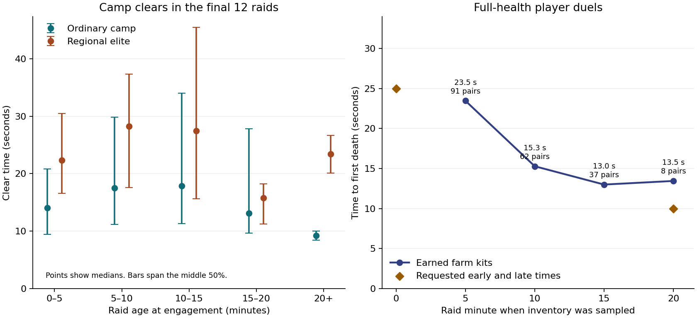

# Room timings on the final local build

All twelve generated maps (seeds 1–12) ran to match end with the final quest prices, post-opening elite defenses, ordinary three-stack farming and the stock RaidBot chooser. Each 40 Hz room had one account-eligible seat driven by RaidBot and seven fill bots. The two observers agreed on termination and terminal tick for every map. The content identity is `cb811d19ebed6dfe` under protocol 24.

## Fight times

Each cell gives median seconds and the number of completed encounters. A camp ends when the entire roster clears. Ten seconds without contact ends a pull. PvP timing measures the last continuous engagement that finished in a player final blow. Separate [full-health solo duel checks](../../raid-routing-ttk/README.md#camp-clears-and-player-kills-over-raid-time) supply a comparable early and late player TTK. Field episodes include teammates, terrain damage and opponents who start wounded. [Timing definitions](../field/README.md#timing-definitions)

| Raid age | Ordinary camp | Elite camp | Player final blow | Healthy solo PvP before lock |
|---|---:|---:|---:|---:|
| 0-5 | 14.05 (424) | 22.30 (55) | 13.16 (2) | — (0) |
| 5-10 | 17.52 (165) | 28.20 (86) | 10.52 (11) | — (0) |
| 10-15 | 17.82 (55) | 27.45 (62) | 14.67 (9) | 4.35 (1) |
| 15-20 | 13.12 (9) | 15.80 (21) | 7.03 (2) | — (0) |
| 20+ | 9.21 (2) | 23.38 (2) | — (0) | — (0) |
| all | 14.78 (655) | 23.69 (226) | 10.36 (24) | 4.35 (1) |

The full-health duel panel uses the inventory both seats actually earned by the sample minute in an independent farming study. Eight surviving pairs supplied the final point. The two ordinary and two elite clears after minute twenty in the final field cohort provide only a small late sample.

The previous stock medians were 14.50 (683) seconds for ordinary clears, 13.82 (311) for elite clears and 8.60 (29) for player final blows.

The fewest recorded damage events on any of the 655 ordinary clears was three. None of the 55 minute 10–15 clears took four seconds or less. Under the 30-second contact-gap definition, the 43 first-pull clears in that interval took a median 25.50 seconds. One input can cause several damage events.

Twenty-three of 24 qualifying player final blows involved multiple hostile owners or other damage. On map 4 a full-health player died to one hostile owner in 4.35 seconds at raid age 13:59, before the gates locked. A single qualifying clean fight cannot estimate the typical duration.

## Room end and bot survival

The median duration was 1326.50 (12) seconds. The shortest room ended after 1089 seconds. The twelve rooms recorded 84 deaths, including 5 before five minutes, 17 before ten and 54 in sudden death. At the production room entry point, one human connection and seven RaidBots started three more matches. At 150 seconds all three humans were standing and the bot counts were 7/7, 6/7 and 7/7. On the first map a bot killed an elite at 145.6 seconds and picked a chest upgrade at 147.5 seconds. [Production room tests](../../../../crates/rh-server/src/room/tests/bot_fill.rs)

## Data and reproduction

[Age and participation groups](timings.csv) · [Individual raids](matches.csv) · [Encounter outcomes](outcomes.csv) · [Replay data for both cohorts](raw.json.gz)

Run `python3 tools/balance-lab/field_pacing_compare.py /tmp/raid-final --seeds 1..13 --read-archive docs/evidence/alpha-balance-targets/final-field/raw.json.gz` to reproduce the three CSVs. The [earlier checkpoint](../field/README.md#reproduce) gives the commands for collecting equivalent runs from source.

Run `python3 tools/balance-lab/field_pacing_plot.py /tmp/raid-final/timings.csv docs/evidence/raid-routing-ttk/route_summary.csv /tmp/raid-times.png` to regenerate the figure.

| Executable | SHA-256 |
|---|---|
| rh-server | `c28298e4d828727127a906f280da856232e116095cc3653247105224dd926b0c` |
| elite_field | `5bf1905b8d0e348604bf56588ed8d56ebd01db89b279c8bcc668eadb631ee892` |
| strategy_ttk | `1564756d5ef87e4a8c7400605c27711b9d9c0b7ffbc14e57c07d32293ea81858` |
