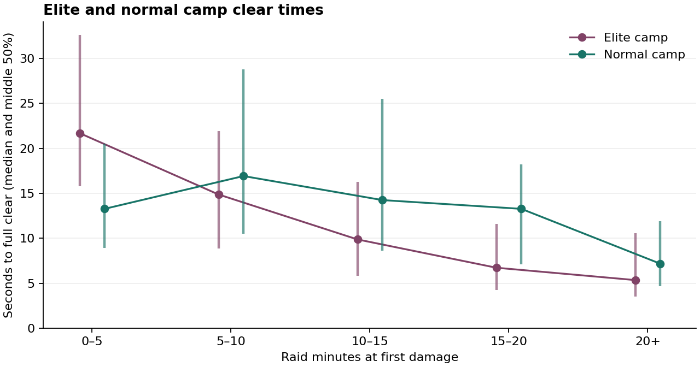

# Quest and elite balance in the playable alpha

The same 80 generated maps, initial seats and 40 Hz alpha rules underpin the quest, elite and augment samples. Eight stock RaidBots played each map, one in a human-eligible seat and seven in ordinary fill seats. Only the human-eligible seat could quest. The raid clock starts after planning. Each map ran to a terminal result and can be compared with the [farming and player TTK study](../raid-routing-ttk/README.md).

## Quests

**Trade Up was the clearest payout outlier.** The focal bot took all 35 offers and cashed out at the highest stage every time. It earned 54 Penitent stacks in a median 51.2 s from acceptance. That is a +54% contribution to the max-HP stat. The same faction's ordinary credited farming rate put the elapsed time at a median 0.92 clears. Transferring that exact payout into developed-kit duels scored 95% against two additional preferred-stat camps and 20% against four. Stage two scored 35% against two camps. The top-stage payout deserves the first quest tuning experiment.

There were 400 planning previews and 800 distinct offers revealed across 80 raids. The focal bot accepted 309 of those offers, made 310 attempts and claimed 309 rewards. One Smuggler's Run timed out and succeeded on retry. All 80 focal players claimed something. The median was four claims, with the median reward claimed 116 seconds into the raid. RaidBot had objective executors for 16 of the 25 quests. The Warden, Bounty Hunter, The Burning Crown, Elite Slayer, A Bone to Pick, Feed or Hunt, Rime Hunt, Whispers in the Brush and Gatecrasher all appeared and drew no accepts. A separate authoritative 40 Hz scenario test completed all 25.

| Quest | Offers | Claims | Median accept to claim | Median ordinary clear credits over that time | Result |
| --- | ---: | ---: | ---: | ---: | --- |
| Trade Up | 35 | 35 | 51.2 s | 0.92 | All claims at the 54-stack stage |
| Let Him Cook | 35 | 35 | 62.6 s | 1.18 | Chef’s Kiss improves the lowest eligible stat |
| Tuber Eats | 36 | 36 | 21.4 s | 0.49 | Breaker’s Helm converts part of bow/axe physical damage to true damage |
| Even Skeletons Get Cold | 35 | 35 | 14.9 s | 0.29 | Warm Coat prevents bog slow and chill |
| Two Banners | 38 | 29 | 23.8 s | 0.42 | All 29 Warhorn rewards went unused by the bot |
| Hold the Fort | 34 | 2 | 48.0 s | 1.24 | The two Turret claims accounted for four casts |
| The Bargain | 37 | 26 | 10.1 s | 0.21 | Also costs farm stacks or a spare weapon |

The comparison prices elapsed time using observed credited camp clears per standing minute outside active quests, with the gates open, by faction. A player may farm while questing. Approaching the giver takes additional time. Shared camp credit, competing human questers and the value of a spare weapon can change the actual price. The per-quest file includes all 25 offers, accepted attempts, failures, timing, claim stage, reward and casts. [Quest funnel](quest_funnel.csv)

**Reward use is a separate bot issue.** Of 142 claimed spell rewards, 110 came from quests whose rewards have no stock RaidBot cast rule. The observer recorded 15 Shoulder Charges and four Turret deployments. In pursuit duels at 180 baseline stacks, Breaker’s Helm scored 20% against one preferred camp, Turret 15% and Warhorn 10%. The duel controller used equipped combat spells independently of RaidBot. Scouting, escape, terrain traversal and ally protection require different encounters. Smite and Rebirth Egg also need their respective mob and multi-player conditions. The prior reward audit exercises those effects directly. [Combat reward comparisons](quest_duels.csv) · [All 25 reward mechanics](../../backlog/packets/P-QUEST25-REWARD-AUDIT-1.md)

## Elite camp difficulty

Across 80 raids, bots made 2,726 elite pulls and finished 2,161 full camps (79.3%). They killed 2,364 bosses. The camp can still have living escorts when its boss dies. A participating player died during 110 pulls, including deaths from other sources. Of the 565 unfinished elite pulls, 563 ended after ten seconds without contact and two ended with the raid. The normal-camp comparison below uses the same observer, clock and end-of-contact rule as the elite encounters.

| Raid age at first damage | Normal clear, median (clears) | Elite clear, median (clears) | Elite boss only, median from first boss damage |
| --- | ---: | ---: | ---: |
| 0–5 min | 13.3 s (2,647) | 21.7 s (337) | 18.2 s |
| 5–10 min | 16.9 s (1,190) | 14.9 s (788) | 12.5 s |
| 10–15 min | 14.3 s (605) | 9.9 s (683) | 8.8 s |
| 15–20 min | 13.3 s (47) | 6.7 s (270) | 5.3 s |
| 20+ min | 7.2 s (11) | 5.4 s (83) | 4.5 s |

The rules contain a reason for the crossover. The earlier farming change `31256fcd0` increased normal kill rewards from one to three stacks and doubled normal mob HP. The local alpha subsequently added armor and shield to ordinary camps after minute five. Elite camps, including their escorts, keep their original defenses as players continue to earn stats and cards. The field comparison includes both this rule difference and the camps bots choose. [Authoritative defense rule](../../../crates/rh-sim/src/state.rs) · [Normal camp pacing change](../../backlog/packets/P-RAID-CAMP-PACE-1.md)

**By minutes 10–15, bots cleared elite camps faster than ordinary camps even when a single player dealt all credited damage.** The solo medians in that window were 8.8 s across 389 elite clears and 13.7 s across 346 normal clears. The early solo medians were 20.7 and 12.1 s respectively. Kits, routes, earlier damage and the types of camp the bots chose still vary. A pull starts on actual damage and closes on a full clear, ten seconds without contact or match end. Successful pulls can include a return to an already damaged camp. The [farming study](../raid-routing-ttk/README.md) used a 30-second break and therefore reports slightly different normal-camp times. [Age bands, solo and grouped](camp_by_age.csv)

Bots cleared Wyrmling camps on 274/300 pulls in a median 4.9 s, Ash Drakes on 235/270 in 5.7 s, Pox Behemoth camps on 177/274 in 18.8 s and Archons on 126/243 in 18.3 s. Blood Saint drew just three field pulls, all unfinished. In a separate scripted solo test, the 12-camp build cleared Blood Saint on 15/15 sword trials and 6/15 bow trials. At that same investment Wyrmling cleared on 22/30 in 16.2 s and Ash Drake on 18/30 in 12.1 s. The solo fighter cleared Executioner on 30/30 in 21.3 s and Avalanche Troll on 14/30 in 61.5 s. These historical solo timings start on the fighter’s first logged damaging hit. A hit on a nearby mob can precede contact with the selected camp. The [later controlled comparisons](../alpha-balance-targets/elites/README.md) use settled damage to that camp’s roster. They use a fixed map, five factions, two weapons, three seeds, no natural regeneration and a 90 s cutoff at the bench’s 20 Hz. The 40 Hz table above supplies the playable-alpha timings. [All ten field elites](elite_by_kind.csv) · [Solo outcomes by build stage and weapon](elite_solo.csv)

**The reward for an elite kill includes more than the card.** The rework pays 12 stacks of the camp’s stat to each eligible standing contributor, subject to the remote-turret rule. Separately, 156 positive elite GV payments went to credited killers. Ordinary mobs and elites share the same 90-GV cap. Payments require an eligible killer and remaining headroom. The observer saw 2,362 of 2,364 expected elite chests. Several players can choose from the same chest. The observers named 3,583 elite card pickups and 187 trophy pickups, with two more positive picks lacking a directly observed choice. No per-kill split of cap exhaustion and eligibility was collected. [Stat payout](../../../crates/rh-sim/src/systems/mob_life.rs) · [Chest and payout records](measurements.zip)

## Elite augments

All 33 unique elite augment candidates from the live faction-filtered chest table were compared with normal farming. Each eligible build played both seats with its faction Wish and signature weapon at two existing investments, 72 and 180 farm stacks. A single card entered the test freshly granted. The alternative kit received either nothing or twelve more stacks in the preferred stat from the earlier nine-stat screen. The farmer also received its additional camp-clear credit. These comparisons isolate the card's marginal value, separate from the elite kill's rewards, and favor effects that help in a committed fight.

| Newly acquired augment, at 180 existing stacks | Score vs 1 preferred camp | Vs 2 camps | Vs 4 camps |
| --- | ---: | ---: | ---: |
| Machine Gun | 100% | 80% | 50% |
| Committed | 100% | 80% | 30% |
| Second Wind | 80% | 55% | 0% |

Each cell in that table represents ten faction/build combinations, three combat seeds and both seating orders (60 exchanges). The alternative camps all pay the chosen stat, a favorable route for the farmer. In the one-camp comparison the mean remaining-health advantage was 28.3 percentage points for Machine Gun, 19.7 for Committed and 9.2 for Second Wind. The field measurements below track effects that take time to build. [All augment duels](augment_duels.csv)

Late survivors commonly held both Machine Gun and Committed. Among participants whose raid had not yet resolved, the median number of named elite cards was 0 at minute five, 2 at ten, 5 at fifteen and 10 at twenty. At minute ten 84/486 (17.3%) had both cards, rising to 77/134 (57.5%) at minute twenty. These are holdings among remaining participants, including anyone downed. One participant's rounded resolution time landed exactly at minute ten and was excluded there. The denominator shrinks as raids end and players are eliminated. [Loadouts by raid minute](elite_loadouts.csv)

The two-card combination also changes full-health PvP pacing. At 180 matched farm stacks the median of 60 controlled exchanges fell from 14.98 s with neither card to 9.80 s when both fighters held the pair. At 72 stacks it fell from 19.94 s to 11.65 s. The fighter holding both cards won every one-sided trial (60/60 at each budget). Most symmetric fights finished on the same tick. The trial times immediate committed combat in equally weighted builds with faction Wishes; human movement and asymmetric field encounters change TTK. [Controlled card-pair fight times](paired_cards_ttk.csv)

All 33 cards appeared and were picked. The field observer saw 7,044 option slots across the 80 raids. The following counts are distinct seat/card holdings acquired from elite chests. A card can be active without a growing counter. Zero growth is meaningful here only for a card with a documented growth trigger.

| Augment | Holders with observed growth | What the bot realized |
| --- | ---: | --- |
| Pathfinder | 44/48 | Median peak +6.6 percentage points of movement speed |
| Hazard Walker | 41/54 | Median peak 9 of 15 stacks, 21 holders capped |
| Executioner’s Ledger | 17/24 | Median peak +7.5 Offense, four capped at +30 |
| Bastion | 1/49 | Its one growing meter peaked at 7.5 of 250 |
| Calluses | 0/50 | No measured increase in its Fists counter |
| Wish Engine | 0/34 | RaidBot’s stock action set does not issue a faction Wish |
| Glacier and Trophy Hunter | 1/1 and 0/1 | The Glacier holder reached +30 armor. Each card appeared just twice. |

In six replays, the six Bastion holders logged zero standing seconds with Shield and the seven Calluses holders logged zero with Fists. Consequently no qualifying blocks or hits occurred for those holders. Focused mechanics tests cover both triggers independently. RaidBot’s equipment and cast decisions limit what these field outcomes say about a human using the card deliberately. [All 33 cards and growth readouts](augment_growth.csv) · [RaidBot actions](../../../crates/rh-policy/src/bots/raid/acts.rs)

## What to tune first

1. Compare a smaller final Trade Up payout or a longer final stage on the same seeds. Keep the three turn-in choices distinct and measure maximum-stage take rate, travel-inclusive cost and the duel advantage over two preferred camps.
2. Give RaidBot an equipment check for Shield/Fists augments, a faction Wish action and cast rules for the unused quest rewards. Then rerun the same seeds and measure qualifying actions per minute held. Add encounters for the nine objectives stock bots currently skip before adjusting their payouts.
3. Test a post-five-minute defense ramp for elite camps against the current rule. Match Wyrmling and Ash Drake trials on starting health, gear, travel time and solo/group size. A whole-camp stat payment and an augment can make a faster elite especially profitable. Keep the early-game pace as a control. Compare routes using the expected reward after walking and clearing.

## Measurement and reproduction

The field observers read authoritative post-step damage and reward events. Quest and augment replays reached identical final state hashes on all 80 maps. The elite replay matched the final field tick and terminal flags on all 80. The paired combat experiment uses two full-health, same-faction fighters with matching weapons and farm kits. Each occupies both starting seats. A win scores one point, a simultaneous death or timeout scores half. The pursuit comparison lets both fighters close again when displacement opens more than 96 units. In the original stationary comparison, 30 of 60 Shoulder Charge exchanges against one camp timed out; in the pursuit comparison, all 60 finished. The duel sample measures an immediate fight at full charges. Future uses of a reusable spell retain additional value outside that exchange.

Combat quest rewards were installed through the authoritative grant and cast path. For Crown Power and Trade Up, whose grant size depends on actual quest progress, the duel reproduces the verified stack payout at the stated stage. The full 25-quest 40 Hz scenario test exercises the genuine turn-in paths. The Bargain needs a choice of input payment and payout, so its field costs and source mechanics are reported separately. [Reproduction commands](../../../tools/balance-lab/README.md#quest-and-elite-balance) · [Packet](../../backlog/packets/P-QUEST-ELITE-BALANCE-FIELD-1.md)

## Packet hand-off

| Field | Record |
|---|---|
| Packet and branch | P-QUEST-ELITE-BALANCE-FIELD-1, Phase 2 item 11. The measurement changes are on `codex/alpha-gameplay-restoration`, with the combined measurement record through `1f87e5dab`. |
| Gate | The standalone local run at `13c8577ae` failed its parity-report step while gameplay identity was changing. The subsequent gameplay packet regenerated both affected content-identity fixtures with the documented command. The [integrated verification](../alpha-balance-targets/README.md) records the final gate on the combined change. |
| Changed | Offline authoritative quest, camp and augment observers, controlled combat comparisons, analysis tooling, packet brief and this evidence directory. |
| D-rules | D1 retains the shipped mechanics for the historical benchmark. D2 compares inputs and terminal outcomes, including mirrored equipment and conditional failures. D5, D6 and D9 have no changes in this measurement packet. |
| Deviations and shared records | None in the measurement packet. Later runtime tuning is in DEV-043. |
| Legacy doubts | Historical target-build weights and direct duels price different aspects of playing a raid. |
| Limits and risks | One quest-eligible focal seat, nine objectives skipped by the stock executor, equipment-dependent cards, few healthy clean field duels, and conditional successful pulls. The controlled follow-up uses a camp-identity check on first contact. |
