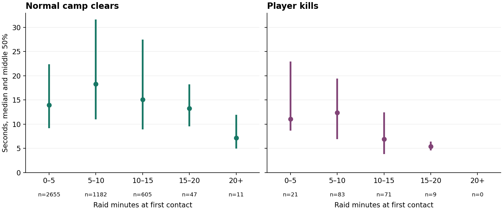

# Faction farming, raid pacing and RaidBot quality

Measured on the local alpha rules from `c1d65623d`, at 40 simulation ticks per second. Raid age begins when planning ends. The route trial uses one human-eligible seat driven by RaidBot and seven ordinary RaidBot fill seats. All eight make decisions through the normal input path. Headless rooms use an eight-seat minimum, a five-second lobby and a three-second fill delay. The separate server-room check exercises the alpha’s actual lobby and fill settings.

## Does a faction-specific route pay for the walk?

At minute ten, targeted earned kits scored **75.4% against random nearby camps** (69 paired survivors, 95% map-bootstrap interval 65.9–84.1%). Against the closest eligible camp their score was **36.3%** (62 pairs, interval 25.0–48.4%). Equalizing both total stacks and credited clears raised the score against nearest to **89.5%** across 57 nonempty pairs (interval 80.7–96.5%). The median targeted farmer had 38 fewer stacks, four fewer clears and 63 more seconds of movement than its nearest-camp counterpart. All 100 maps reached ten minutes in both arms. Targeted was alive on 79, nearest on 75, and both were alive on 62.

The route trial comprised 300 primary raids (100 maps × three approaches), 60 held-out bounded-route raids and ten stock-route controls. The table reports the targeted kit’s duel score, with eligible map pairs in parentheses. Both seating orders count as one map. The last column isolates stat composition at the same total budget.

| Active minute | Targeted vs nearest, earned | Targeted vs random, earned | Targeted vs nearest, equal budget |
| ---: | ---: | ---: | ---: |
| 5 | 40% (91) | 67% (92) | 71% (73) |
| 10 | 36% (62) | 75% (69) | 89% (57) |
| 15 | 47% (37) | 82% (48) | 86% (35) |
| 20 | 50% (8) | 85% (13) | 75% (8) |

On the 60 held-out maps, the four-second detour cap scored 38.5% against nearest at minute ten (39 surviving pairs, interval 24.4–53.8%). The unrestricted targeter scored 37.2% against nearest on those same assigned maps (39 pairs). Bounded scored 62.8% against unrestricted directly (43 pairs, interval 50.0–76.7%) and 74.4% against random (41 pairs). Capping the walk recovered farm, but the measured build advantage still did not cover its cost against nearest.

Final room placement gave a different view. Across the 82 maps where both focal results resolved, unrestricted targeting placed higher than nearest on 40, tied on 14 and placed lower on 28. It averaged 0.62 places higher and took first place 10 times against nearest's three. The 18 unresolved pairs at the simulation cap limit conclusions about overall raid wins. Against the stock route, there were only seven surviving pairs at minute ten; the targeted score was 57.1% (interval 28.6–100%). These data support another bot routing experiment before replacing the ordinary policy. [Primary scores](route_summary.csv) · [Bounded scores](bounded_summary.csv) · [Primary placements](placements.csv) · [Bounded placements](bounded_placements.csv)

### Minute-ten results by build

Each row started with ten matched maps. The numbers in parentheses are the surviving pairs available for that comparison, so individual build rankings remain tentative.

| Build | Vs nearest | Vs random nearby | Vs nearest at equal budget |
| --- | ---: | ---: | ---: |
| Fire sword | 20% (5) | 88% (4) | 60% (5) |
| Fire shield | 40% (5) | 80% (5) | 100% (5) |
| Sentenced sword | 17% (6) | 67% (6) | 100% (5) |
| Sentenced bow | 0% (4) | 88% (8) | 75% (4) |
| Plague wand | 50% (6) | 86% (7) | 80% (5) |
| Plague commander | 61% (9) | 89% (9) | 100% (9) |
| Frost shield | 57% (7) | 71% (7) | 67% (6) |
| Frost bow | 25% (8) | 50% (7) | 100% (7) |
| Holy axe | 50% (6) | 78% (9) | 100% (6) |
| Holy wand | 17% (6) | 57% (7) | 100% (5) |

## Camp clears and player kills over raid time

The stock-bot timing trial covered 80 complete eight-seat raids and 4,500 normal camp clears. Each cell gives the median seconds from first damage to the completed outcome, with the number of camps, victims or paired maps in parentheses. Earned-kit duels use the targeted and nearest farmers' actual inventory at the **end** of each five-minute interval, then exchange sides in a full-health fight. Field contacts are grouped by their **starting** minute.

| Active raid time | Field camp TTK | Field PvP TTK | Full-health earned-kit PvP TTK |
| --- | ---: | ---: | ---: |
| 0–5 min | 13.92 s (2655) | 11.05 s (21) | 23.48 s (91) |
| 5–10 min | 18.30 s (1182) | 12.40 s (83) | 15.29 s (62) |
| 10–15 min | 15.05 s (605) | 6.93 s (71) | 13.00 s (37) |
| 15–20 min | 13.27 s (47) | 5.40 s (9) | 13.45 s (8) |
| 20+ min | 7.17 s (11) | No completed kills (0) | No later checkpoint |

Among the 605 completed 10–15 minute camps, 33 cleared in four seconds or less (5.5%). Six of those 33 were return visits to a camp that had already lost members. The 500 pulls without a recorded partial roster had a median of 15.18 s. At minutes 15–20, 30 of 47 clears resumed a partial camp. Across all 4,500 clears, none took only one recorded hit. Eleven camps cleared after minute 20 across eight maps, so the late median is sensitive to which camps and farmers remained. The field had 176 mixed deaths among 184 player-final-blow contacts. Of those 184, only one met all the single-attacker, healthy-start and unlocked-at-contact criteria. The ordinary field fight and the full-health duel therefore answer different pacing questions. At 10–15 minutes, fights that began with at least 90% victim health lasted a median 11.70 s (26 kills), compared with 6.93 s across all player kills in that band.

The observer retained 1,528 abandoned camp contacts, 5,083 interrupted player contacts and nine cases where a non-player source finished an open player contact. Completed-fight medians exclude these windows. [Timing distributions](field_ttk.csv) · [Contact counts](field_contacts.csv) · [Room outcomes](field_results.csv) · [Raw measurements](measurements.zip)

## What to tackle next

1. **Price camp choices in actual seconds.** Use observed clear time by raid age, weapon and camp type, then compare the next useful stack against the extra walking, health risk and contested camps. Re-test against nearest on fresh maps using earned-kit strength and final placement. A promotion criterion would be a minute-ten earned-kit score above 50% with a 95% interval above even, plus comparable survival and room placement. If a better route still loses, test a change to the distribution or payout of specific stat camps and measure the same outcomes. The old four-step routing study used a different farming and contest model.
2. **Give bots a specific Coliseum combat response.** Sudden death accounted for 316 of 560 final eliminations (56.4%). All 80 stock-bot raids resolved; the median winner's recorded duration was 20 min 9 s, and none ended within a minute. Keep the 150-second real-room survival check while testing retaliation, target selection and use of abilities after the gates lock. The existing executor registry has farm and elite combat. The PvP and Coliseum goal slots still lack dedicated executors. [Raid executor registry](../../../crates/rh-policy/src/bots/raid/exec/mod.rs) · [Coliseum settlement](../../../crates/rh-sim/src/systems/coliseum.rs)
3. **Playtest full-health fights with movement before changing global damage.** The existing fixed-kit benchmark hits the requested early and late pace. Kiting, off-faction opponents and augmented builds may move those results. Retain separate checks for full-health duels, wounded targets, fights with mobs and third-party attackers, and fresh versus resumed camp pulls. Record where the player disengages and where a brief skirmish turns lethal.

## What a camp stat bought

We gave two fighters the same faction, signature weapon and balanced farm inventory. Each then received twelve extra stacks in a different stat. Each choice faced all eight alternatives on three combat seeds in both seating orders. The following leaders include the faction Wish. A score counts a win as one and a simultaneous death or timeout as half. Ties in a row have the same score.

| Farm build | Best next stat at 72 existing stacks | Best next stat at 180 existing stacks |
| --- | --- | --- |
| Fire sword | Ability power | Attack damage |
| Fire shield | Magic resistance | Magic resistance |
| Sentenced sword | Attack speed | Damage multiplier |
| Sentenced bow | Damage multiplier | Attack speed |
| Plague wand | Ability power | Ability power |
| Plague wand with one zombie | Ability power | Ability power |
| Frost shield | Attack speed | Armor or max HP |
| Frost bow | Attack speed | Armor, lifesteal or max HP |
| Holy axe | Damage multiplier | Attack speed |
| Holy wand | Damage multiplier | Damage multiplier |

This screen measures the next camp in a stationary, same-faction duel. A bow user gains different value from movement speed while kiting. Sustaining a pull, chasing an opponent, escorting a summon and fighting a different faction also change a stat's value. The ten builds and their historical weights come from the [ported build table](../../../crates/rh-policy/src/bots/build_route.rs). The [stat scores](stat_summary.csv) include weapon-only and Wish-enabled combat at both budgets.

## How the routing trial works

The same seed fixes the map, faction, A/B build, focal seat and competitors. The baseline always chooses the nearest eligible camp by estimated walking time. The random farmer sticks with a uniformly selected camp among the five nearest eligible choices. The targeted farmer values the public reward stat using the ten authored sets of weights and estimated time to walk and clear. All three see the same candidate list. The bounded farmer additionally requires the detour to cost at most four estimated walking seconds. That rule was chosen using eleven exploratory maps and evaluated separately on seeds 41–100. The ordinary RaidBot comparator uses its stock farm policy.

At minutes 5, 10, 15 and 20 the lab records the focal player's status, stacks, credited clears and movement. The earned-kit comparison transfers only those farm stacks and credited clears into full-health duels, with the same faction and weapon. Holy carries its actual clear count and the Plague commander starts with one raised zombie. The equal-budget comparison rescales both inventories to the lower stack count and lower credited clear count. Each kit occupies both seats. Both fighters re-aim, attack in range and use their Wish when available. Holy uses it below half health. Field weapons, augments, quest items, chests and tactical movement are outside these farm-only duels.

An independent map contributes one seating-averaged score if both farmers reached the checkpoint alive. Every assigned map remains in the status and placement data. A 95% interval resamples independent map scores with replacement. The time spent moving counts ticks with at least one unit of displacement and can include combat, forced movement and transport. The bounded rule uses estimated walking time for an individual decision. Those two measurements describe different parts of the route. Placement includes everything the bot actually did in the raid.

## Controlled pacing checks

On a fresh run of the 40 Hz fixed-loadout bench, 450 starter duels had a median of 25.20 s (10th–90th percentile 22.43–28.98 s). The 288-stack farmed kit median was 9.43 s (7.17–13.85 s) and farmed kits with augments took 11.38 s (6.67–18.77 s). These are fixed-build benchmarks. Actual earned kits at each raid minute and live-field contacts are measured separately above.

The controlled normal-camp test replayed three camps and three factions with a fixed sword, fixed stacks, no Wish and no regeneration. At minute 10 the offense-focused build cleared all nine pulls in a median 20.70 s. At minute 20 it cleared eight of nine in 31.20 s. The ordinary build cleared eight of nine in 37.03 s at minute 10 and seven of nine in 52.10 s at minute 20. Medians include successful pulls. These encounters hold the farmer's stats fixed while camp defenses progress. [Camp pacing test](../../../crates/rh-headless/tests/raid_camp_clear.rs) · [Controlled duel bench](../../../crates/rh-headless/src/pvp_bench.rs)

## How the timing trial works

In separate stock-RaidBot matches, the observer reads settled per-hit damage after each simulation step. Normal camp timing runs from the first player or owned companion hit to the complete camp clear. A 30-second gap closes the attempt as abandoned. A renewed pull on a previously abandoned partial camp is flagged. Player timing starts with the first hostile player or companion hit on that victim. A gap of ten seconds ends the contact. A completed kill needs a hostile player or owned companion to land the final blow. Deaths to wildlife, self damage or sudden death have separate outcomes. Each episode belongs to the age band of its first hit.

The field distribution includes wounded players and mixed fights. The narrower subgroup requires at least 90% victim health at contact, a single attacker, no observed environmental hits, and unlocked gates at contact. The room clears the lock after a death, so the post-step lock flag in a result cannot identify whether a death happened inside the Coliseum. The named sudden-death cause comes from the ledger. Arena burn is absent from the settled-hit feed and may start while a fight is in progress. Summary files retain contributing map counts, interrupted and open attempts, one-hit counts and the middle 50% of completed times. The interval on the median resamples contributing maps, keeping episodes from one map together. The final room records retain the server's credited killer. That record and the exact final blow can differ.

## Server-room check

One simulated human joined each production-code server room. All seven fill bots moved and sent accepted actions. At 150 active seconds, 7/7, 6/7 and 7/7 bots were still standing on seeds 3, 11 and 17. The human remained alive in all three. On seed 3 the first elite died at active tick 5,825 and the first bot took a chest upgrade at tick 5,901 (145.6 and 147.5 seconds). Ten baseline stock-bot replay reports and their final state hashes still match the preceding alpha byte for byte. These validations exercise the server room and deterministic simulator on the local machine. [Server-room tests](../../../crates/rh-server/src/room/tests/bot_fill.rs)

## Reproduction

The [lab commands](../../../tools/balance-lab/README.md#faction-farming-and-fight-timing) build the measurement binaries, run all arms and regenerate the CSVs and timing chart. The [packet](../../backlog/packets/P-RAID-ROUTE-TTK-1.md) describes the baseline and the held-out comparison. The [earlier ten-build study](../../../testing/FARM_ROUTE_PROOF.md) used an older farming and combat model.
